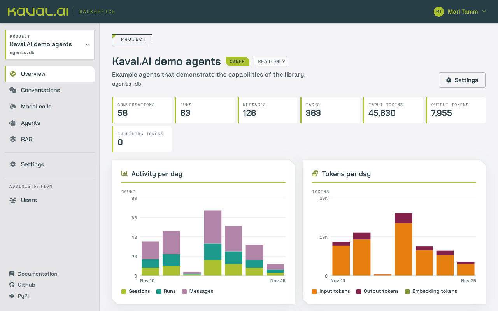
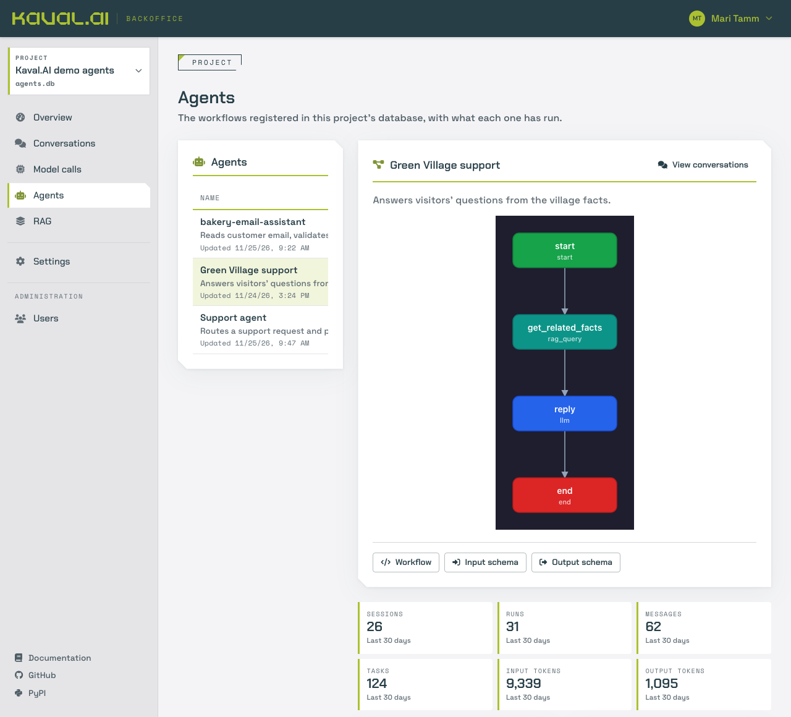
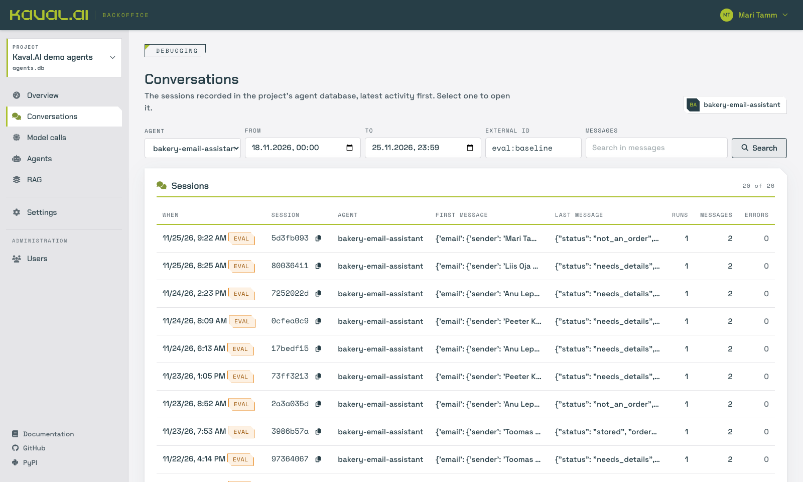
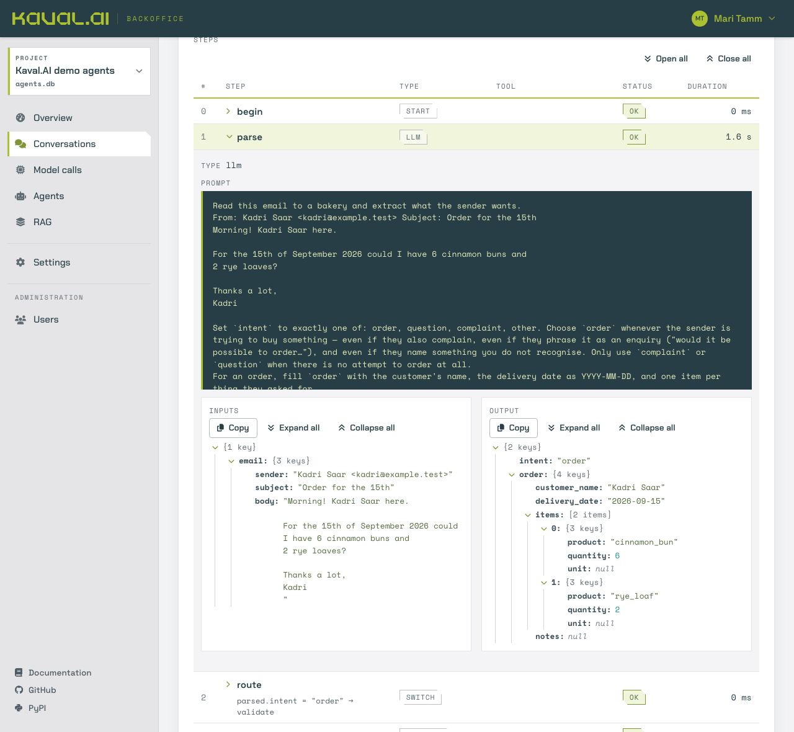
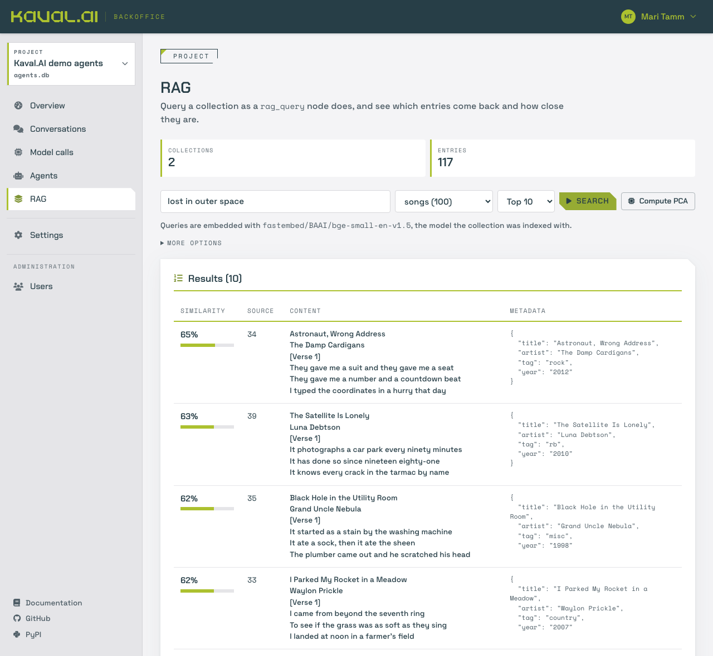
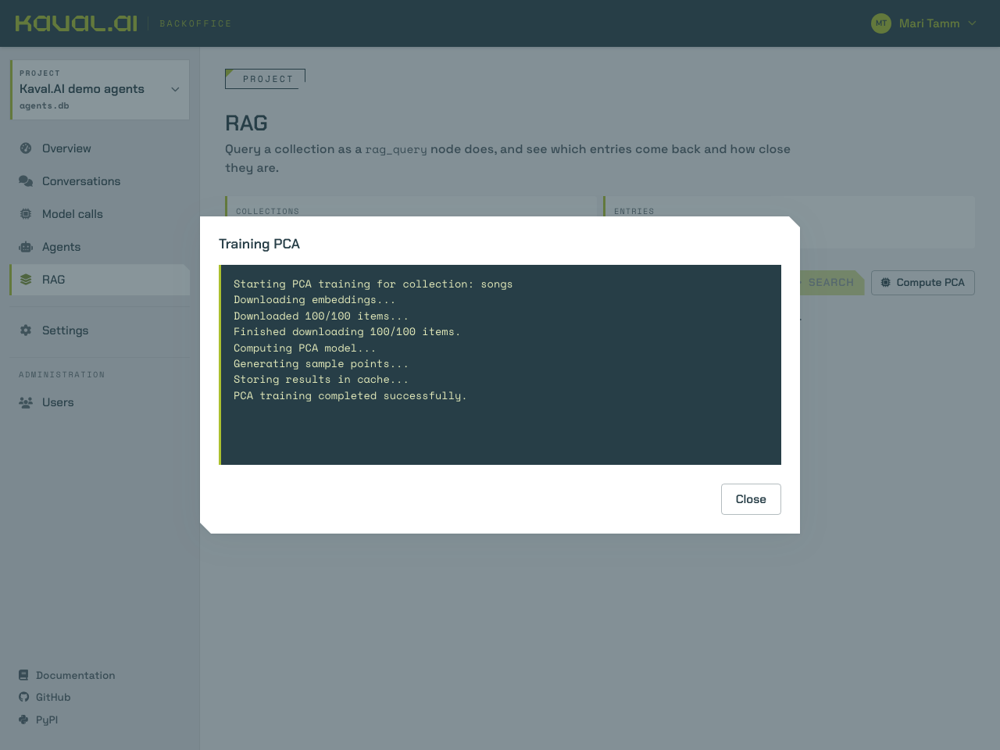
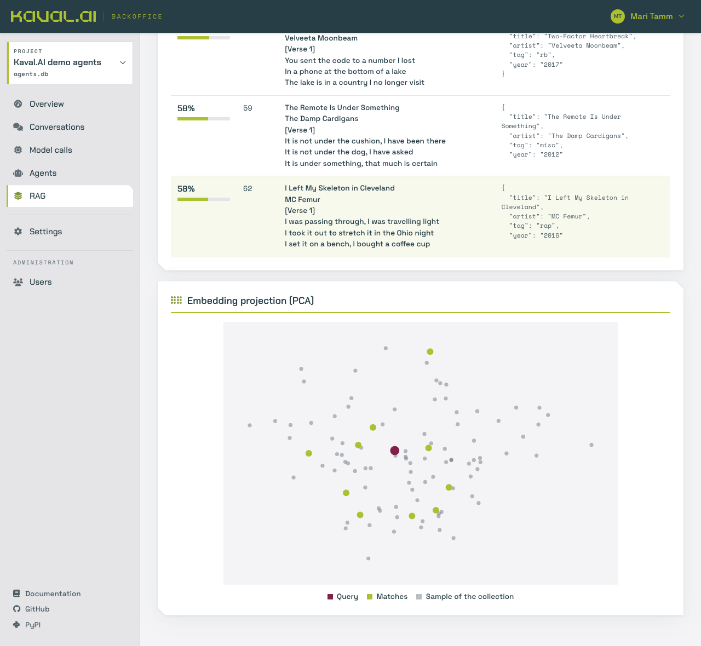

Using the Backoffice UI
=======================

The **backoffice** is Kaval.AI's management and monitoring interface — a FastAPI
service (:mod:`kavalai.backoffice`) backed by PostgreSQL or SQLite, with an
Angular front end. While the SDK *runs* your agents, the backoffice is where they are
**configured, inspected and observed**: every session, run, node and model call
a workflow produces is recorded and browsable here. It is the visual side of
Kaval.AI's *observable* pillar.

The backoffice reads two databases, and never the same one twice. Its own
schema holds projects, users and memberships; each **project** it manages points
at an *agent* database, which is where the runtime writes. The separation is
deliberate: an agent database can be handed to the backoffice read-mostly, and
several environments — local, staging, production — can be inspected from one
interface without their runtime data ever meeting.

.. contents:: On this page
   :local:
   :depth: 1

Running the backoffice
----------------------

Three things must exist before the interface is usable: a database carrying
both schemas, a configured sign-in, and one user to sign in as. They are treated in that order below. PostgreSQL is the production choice;
SQLite serves a single machine, as described at the end of this section.

Setting up PostgreSQL
^^^^^^^^^^^^^^^^^^^^^

The repository's ``docker-compose.yml`` provides an instance with the
``pgvector`` extension already present, which the RAG tables require:

.. code-block:: bash

   docker compose up -d postgres_db

It exposes PostgreSQL on host port ``6543`` with the development credentials
``kavalai_dev`` / ``kavalai_dev`` and a database of the same name, storing its
data under ``local_data/pgdata``.

An existing PostgreSQL server (version 13 or later) serves equally well. Only a
database and a role permitted to create an extension are needed:

.. code-block:: sql

   CREATE DATABASE kavalai;

Then, connected to that database:

.. code-block:: sql

   CREATE EXTENSION IF NOT EXISTS vector;

The schemas themselves need not be created by hand. Each migration set issues
``CREATE SCHEMA IF NOT EXISTS`` for its target before it runs, and the agents
set creates the ``vector`` extension as its first revision:

.. code-block:: bash

   # The backoffice's own tables: projects, users, memberships, caches.
   python -m kavalai.migrate_db backoffice

   # The agent runtime tables the backoffice reads: sessions, runs, tasks,
   # model call statistics.
   python -m kavalai.migrate_db agents

Both are idempotent and both read their connection from the environment —
``KAVALAI_BO_DB_URI`` / ``KAVALAI_BO_DB_SCHEMA`` for the first,
``KAVALAI_DB_URI`` / ``KAVALAI_DB_SCHEMA`` for the second. The two schemas may
share one instance, as they do in the development stack, or live on entirely
separate servers. Every variable is listed in :doc:`../reference/config`, and
the production arrangement in :doc:`../deploy/index`.

The RAG tables — the ``rag_collections`` registry and one table per
collection — belong to neither migration set. A RAG service creates them on
first use, which is its default. A service constructed with
``provision=False`` issues no DDL, so that the runtime role can hold data
privileges only; the registry and the collections are then created beforehand
by a job running under a role with owner privileges, through
``ensure_registry()`` and ``create_collection()``. The backoffice creates
neither: its RAG explorer reads the collections that exist, and a project
without any shows none.

Using SQLite instead
^^^^^^^^^^^^^^^^^^^^

Both variables also accept a ``sqlite:///path`` URI, and the schema variables
are then ignored, since SQLite has no schemas. The same two commands create
the tables in the named files:

.. code-block:: bash

   KAVALAI_BO_DB_URI=sqlite:///local_data/backoffice.db \
       python -m kavalai.migrate_db backoffice
   KAVALAI_DB_URI=sqlite:///local_data/agents.db \
       python -m kavalai.migrate_db agents

An agent server started with the same ``KAVALAI_DB_URI`` writes its sessions,
runs and tasks into that file, and a project of type **SQLite** pointing at
the file shows them. This suits development, a demonstration or a laptop: the
agent server and the backoffice must share a filesystem, and SQLite on a
network mount is not safe for a writer, so PostgreSQL remains the choice for a
deployment with more than one host.

Configuring sign-in
^^^^^^^^^^^^^^^^^^^

A user signs in with an address and a password, with a Google account, or
with either. Password sign-in needs no configuration beyond the key that
signs the session cookie:

.. code-block:: bash

   # Signs the session cookie. Required: there is no development fallback.
   KAVALAI_BO_SESSION_SECRET_KEY=...

Google sign-in is optional. To offer it, create an OAuth client in the Google
Cloud console, register ``{backoffice}/auth/google/callback`` as its authorised
redirect URI, and set:

.. code-block:: bash

   KAVALAI_BO_GOOGLE_CLIENT_ID=...
   KAVALAI_BO_GOOGLE_CLIENT_SECRET=...

   # Where a completed Google sign-in is redirected to.
   KAVALAI_BO_FRONTEND_URL=http://localhost:8000

With neither Google variable set, the sign-in page shows the password form
alone and the Google routes answer ``404``. Setting one without the other
stops the start-up, since a half-configured client is a mistake rather than a
choice.

The backoffice stores no passwords. ``users.password_hash`` holds a salted
scrypt hash that records its own cost parameters, so the parameters can be
raised later without invalidating existing accounts. A user whose hash is
``NULL`` can sign in through Google only.

Starting the service
^^^^^^^^^^^^^^^^^^^^

The development stack builds the image, applies the backoffice migrations and
serves the interface — API and compiled front end together — at
``http://localhost:8000``:

.. code-block:: bash

   docker compose up postgres_db backoffice-migrations backoffice

To run it from a checkout instead, start the API and the Angular development
server separately. The API binds to ``KAVALAI_BO_HOST`` / ``KAVALAI_BO_PORT``,
and the front end proxies to it, so ``KAVALAI_BO_FRONTEND_URL`` must then name
the Angular port:

.. code-block:: bash

   python -m kavalai.backoffice.server      # API, port 12800 unless set
   cd frontend && npm start                 # UI on http://localhost:8400

Signing in
^^^^^^^^^^

The landing page shows a form for the address and the password, and beneath
it a **Sign in with Google** button when a Google client is configured. A
refused password sign-in answers ``401 Invalid email or password`` whether the
address is unknown, has no password or the password is wrong, so the page
does not reveal which addresses are registered.

Creating the first user
^^^^^^^^^^^^^^^^^^^^^^^

Sign-in authenticates an identity; it does not grant one. An address is
admitted only if it already appears in the ``users`` table — a Google account
with an unknown address is refused with ``403 User not registered in the
system`` and the attempt is logged. Nothing self-registers, which is why an
installation that has just been migrated cannot yet be entered by anyone.

The first user is therefore created from the command line, with the script
that ships in the package. Make it an administrator: only administrators may
create projects and further users.

.. code-block:: bash

   python -m kavalai.backoffice.users add you@example.com \
     --name "Your Name" --admin

The script prompts for the password twice and stores only its hash. The
password is never a command-line argument, which would leave it in the shell
history and the process list; ``--password-stdin`` reads it from standard
input instead, for use from a provisioning script. A password is at least
eight characters long. The script reads ``KAVALAI_BO_DB_URI`` and
``KAVALAI_BO_DB_SCHEMA`` as the server does, or takes ``--db-uri`` and
``--db-schema``; in a container it is run with ``docker exec`` in the
backoffice container.

Two further forms cover the remaining cases:

.. code-block:: bash

   # A user that signs in through Google only: no password is stored.
   python -m kavalai.backoffice.users add you@example.com --admin --no-password

   # Replace the password of an existing user.
   python -m kavalai.backoffice.users set-password you@example.com

For Google sign-in the address must match the Google account exactly;
``name`` and ``picture`` are overwritten from the Google profile on every such
sign-in, so their initial values matter little.

Once that account can sign in, further users are added from the **Users**
page or with the same script, and every project from the interface itself.

Projects
--------

Everything in the backoffice is scoped to a **project**. A project carries a
name, a description, the connection details of its agent database, its members,
and a cache in which derived artefacts such as trained PCA models are kept. The
**Database Type** selects how the connection is described: a PostgreSQL project
names host, port, user, password, database and schema; a SQLite project names
the database file, which the backoffice must be able to read from its own
filesystem. A PostgreSQL project may also name a **RAG Schema**, for a
deployment that keeps its RAG collections in a schema of their own beside the
runtime tables; left empty, the collections are looked for in the schema above.
The project page is where the active project is chosen, new ones are created,
and the connection is verified.

The database password is write-only. Every member of a project receives its
settings, and the password would let a viewer connect to the agent database
around their role and around the read-only setting below, so no page or
endpoint that lists a project carries it. A form that leaves the password
empty keeps the stored one — but only while the database type, host, port,
user and database stay the same; changing any of them asks for the password
again, so whoever may edit the host cannot send the stored password to another
server. An administrator who needs the password, to build a connection string
of their own, asks for it with **Show password** beside the connection strings;
the request is logged. **Test connection** checks the settings as they are
typed, before they are saved.

**Read-only** is on for every project unless switched off. The backoffice only
reads an agent database, and the database it is pointed at may be production,
so the guarantee is placed where it cannot be argued with: every connection a
read-only project opens is set to refuse writes by the database itself —
``default_transaction_read_only`` on PostgreSQL, ``PRAGMA query_only`` on
SQLite — whatever the connecting role would otherwise be allowed to do, and
the RAG explorer's service never creates a registry or a collection. A
project can be switched to read-write, which changes nothing today, since no
page writes; the switch exists so that a future page that must write cannot
do so on a project nobody opened for it.

         and seven-day activity and token charts
   :width: 100%

The **Statistics (Last 7 Days)** panels are read from the agent database rather
than from the backoffice's own: sessions, messages, tasks and workflow runs on
the left, input, output and embedding tokens on the right. They are the first
indication that a project's connection is sound and that the runtime is in fact
writing to the schema the project names.

The selected project follows the user across pages, and is stored as
``active_project_id``. If the project is later deleted, or the membership
revoked, that value is re-resolved on the next page load rather than left to
answer ``403`` — a session that goes stale repairs itself without a re-login.

Agents
------

The **Agents** page lists the agents that have written to the active project's
database. Selecting one renders its workflow as a graph — the same renderer the
documentation uses, so the picture in the interface and the picture in
:doc:`../tutorials/workflow` are produced by one code path — alongside the
declared **Input** and **Output** models and the agent's headline counters.

         graph, with total sessions, messages, runs and tasks beneath it
   :width: 100%

The graph is the workflow as the engine parsed it, not as it was written: node
names carry their type beneath them — ``rag_query``, ``llm``, ``start``,
``end`` — so a definition can be checked against what is actually being served.

The counters below it (total sessions, messages, runs and tasks) and the
seven-day charts describe one agent rather than the whole project, which makes
this the quickest view for judging how heavily a single agent is used.

Workflow monitoring
-------------------

The **Workflows** page is a monitoring timeline: one row per agent, one marker
per recent run. Completed runs are filled and empty runs are flagged, which
gives an at-a-glance health view across every agent in the project and a route
into any individual run.

Conversations
-------------

A **conversation** is a session: the runs triggered within it, the messages
exchanged, and the errors raised. The list is filtered by agent, by date range,
and by external identifier — the last of these is how evaluation runs are found,
since :doc:`../guides/evaluation` records each case under
``eval:{tag}:{case}``.

         run, task, message and error counts with the first and latest payloads
   :width: 100%

Each entry shows the counts for that session and, below them, its first and
latest payloads. Because a Kaval.AI workflow's boundaries are typed, those
payloads are structured data rather than prose: in the illustration the bakery
assistant's latest output carries ``status``, ``order_id`` and ``missing``
beside the human-readable ``subject`` and ``body``, so what the workflow decided
is legible without reading what it wrote.

The list is ordered by **last activity** — the time of a session's most recent
run — and that is the time each entry shows. A conversation resumed today
therefore stands above one begun today and left idle since. The date range,
by contrast, filters on the time a session was created.

The task debugger
-----------------

Opening a conversation descends one further level, to the runs it contains and
the tasks each run executed. A run names its nodes in execution order, and every
node can be opened on its own.

         output opened in an expandable JSON viewer
   :width: 100%

Each task records its duration and its status, and exposes the value that
entered it and the value that left it. The output opens in an expandable
viewer: here the ``parse`` node's result is the order it extracted from a
customer's email — two items with product, quantity and unit, a customer name, a
delivery date and the intent it classified. The **Input**, **Output** and
**Context** buttons at run level show the same for the run as a whole.

A ``rag_query`` node records its retrieval in the same place. Its inputs name
the query, the collection, ``top_k``, ``source_ids`` and ``min_similarity``;
with ``store: content`` its output holds the joined passage text as
``content`` and, as ``hits``, the identifier, source identifier, similarity and
metadata of each passage, so a retrieval can be judged from the task without
running the query again.

The run's context also carries the per-run template values a caller passed,
as ``run_templates``, since a prompt cannot be explained without them. A
failed run is recorded too: its context holds ``status`` and ``error`` and,
unless the engine was created with ``record_context=False``, the ``data`` the
run had reached.

Beneath the tasks, **Model Calls** lists the model calls the run made, oldest
first — model, call type, input, output and total tokens, and duration — with
the run's token total and a link to the same calls on the Model calls page.
The embedding calls of the run's ``rag_query`` nodes are among them. The
section shows the hundred most recent calls, and is absent when the run made
none.

This is the intended way to answer "why did it do that": each node's own input
and output are stored, so a wrong answer can be traced to the step that first
went wrong rather than inferred from the final reply. The rows come from the
task-logger backend described in :doc:`../guides/observability`, and are
written only when a workflow is run with one configured.

Model calls
-----------

The **Model calls** page lists every LLM and embedding call the runtime made:
provider and model, status, duration, prompt and completion tokens — cached
prompt and reasoning tokens among them — and the request and response payloads.
Each row is a :class:`~kavalai.ModelCallStat`. There is no cost column, and
deliberately so: providers report tokens rather than money, and cached input is
priced differently enough that a derived total would be wrong rather than
merely stale.

Each call is attributed to the run that made it: a row carries the run's
``run_id`` and ``session_id``, the embedding calls of a workflow's
``rag_query`` nodes included, whose response payload records no vectors.
Neither identifier is a foreign key, so the token counts outlive the
conversation they belong to. A card links to its conversation and to the
run's tasks, and its run identifier narrows the page to that run's calls. The
same filters are the page's ``run_id`` and ``session_id`` query parameters,
which is how the **Model calls** button of a conversation and the task
debugger reach it; **Show all calls** removes them.

RAG explorer
------------

The **RAG** page is the interface's answer to a question the SDK can only
answer in a notebook: what is actually in this index, and does it retrieve what
one would expect? It reads the project's vector collections directly through
the project's RAG service — :class:`~kavalai.rag.PostgresRagService` or
:class:`~kavalai.rag.SqliteRagService`, which share one storage model (see
:doc:`../guides/data_model`) — so it needs no agent, no workflow and no running
server — only a project whose database holds an index.

         showing similarity, source ID, content, collection and metadata
   :width: 100%

Two counters head the page — the number of collections in the database and the
total number of indexed entries across them. Beneath them sits the query form,
whose controls correspond one for one to the arguments of
:meth:`~kavalai.rag.BaseRagService.query`:

.. list-table::
   :header-rows: 1
   :widths: 22 78

   * - Control
     - Effect
   * - **Query Text**
     - The text to embed and search with. Pressing *Enter* submits it.
   * - **Collection**
     - Which collection to search, listed with its number of entries.
       Collections are the unit of separation within one schema, and each is
       a table of its own, so a query searches exactly one. The ``default``
       collection is selected when there is one, otherwise the first.
   * - **Embedding Model**
     - The ``provider/model`` identifier the selected collection was indexed
       with, as recorded in the collection registry. It is shown rather than
       chosen: the RAG service embeds every query against an existing
       collection with that model, since a different model yields a different
       vector space, and therefore meaningless neighbours.
   * - **Source IDs**
     - Restricts the search to given source identifiers — the way to ask what a
       specific document contains rather than what the corpus does.
   * - **Top K**
     - How many neighbours to return.
   * - **Keep Best Only**
     - Collapses the chunks of a single document to its best-scoring chunk, so
       that a long document cannot occupy every result slot.
   * - **Normalizer YAML**
     - An optional normalisation specification applied to the query text before
       it is embedded. It exists so that a query can be normalised exactly as
       the corpus was at indexing time.

Results are returned ranked by **similarity**, reported as
higher-is-better cosine similarity (``1 - distance``) on every backend, so the
figures are comparable across storage engines. Each row carries its source
identifier, the retrieved content, its collection, and the metadata it was
indexed with — the same ``rag_metadata`` a
:class:`~kavalai.rag.RagServiceResult` exposes to a workflow. Reading a
retrieval failure off this table is usually immediate: either the intended
passage is absent from the index, or it is present and ranked below something
else.

Projecting the embedding space
^^^^^^^^^^^^^^^^^^^^^^^^^^^^^^

Similarity figures say how close a match is; they do not say what the
neighbourhood looks like. **Compute PCA** fits a two-dimensional projection of
the collection so that it can be seen.

Training streams its progress over Server-Sent Events and can be stopped from
the dialog. The embeddings are exported from the collection, an incremental PCA
is fitted over them in batches, and both the fitted model and a sample of 500
projected points are stored in the project's cache. The work is done once per
collection: subsequent queries reuse the stored model, and a page whose
collection has no model yet says so plainly rather than showing an empty plot.
A query is projected from an embedding computed with the collection's recorded
model, the space in which the PCA was fitted.

         matches in blue and the cached training sample in grey
   :width: 100%

The projection then accompanies every query against that collection. The
cached sample is drawn in grey as the shape of the corpus, the query in red,
and its nearest neighbours in blue; hovering a point reveals what it is. Two
components of a many-hundred-dimensional space are a lossy summary and should
be read as one — but they answer questions a ranked list cannot. Whether the
retrieved matches form a cluster or are scattered, whether the query falls
inside the corpus or at its edge, and whether a collection is one body of text
or several, are all visible at a glance. A query that lands far from every grey
point is a query the index was never built to answer, and the similarity
figures beneath it should be read in that light.

Users and access
----------------

The **Users** page is administrator-only. It is where accounts are created
after the first — an address and a name, with the administrator flag granted or
withheld — and where they are removed. An account created there has no
password and signs in through Google; a password is given with
``python -m kavalai.backoffice.users set-password``. An administrator cannot delete their own
account, which prevents an installation from being locked out of itself.

Membership is granted per project, in one of two roles. A **viewer** may read
everything the project exposes; an **owner** may in addition edit the project,
manage its members and delete it. The last owner of a project can be neither
removed nor demoted, so a project cannot be orphaned. Every project-scoped
endpoint verifies membership on the server, so the interface hides only what
the API would refuse in any case.
